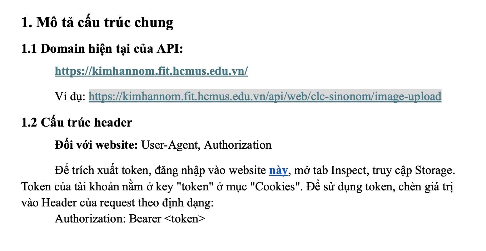
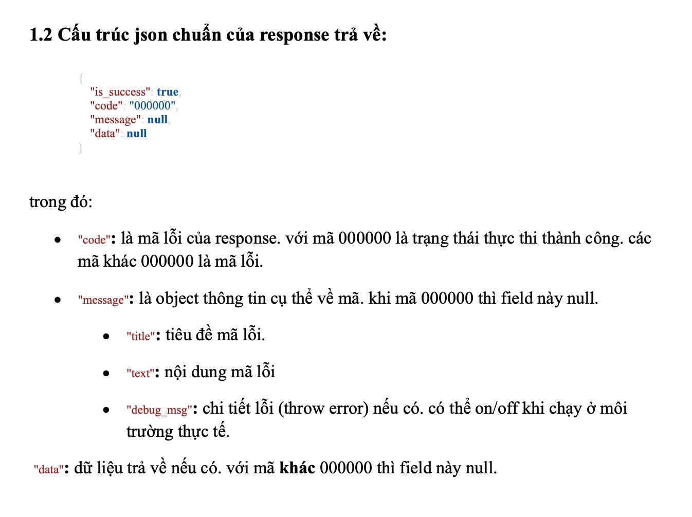
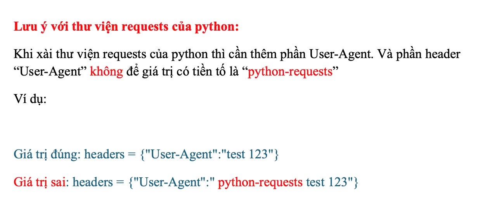
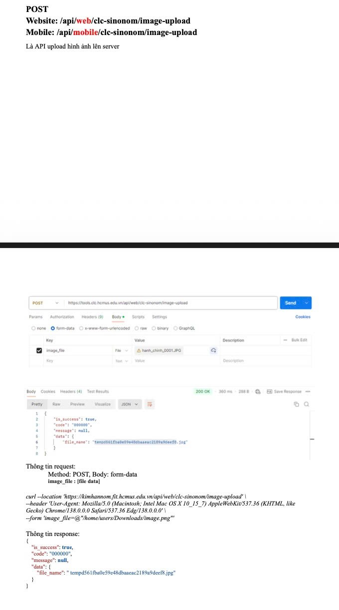
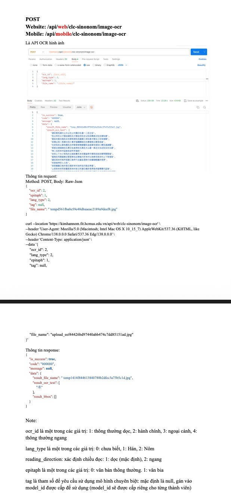
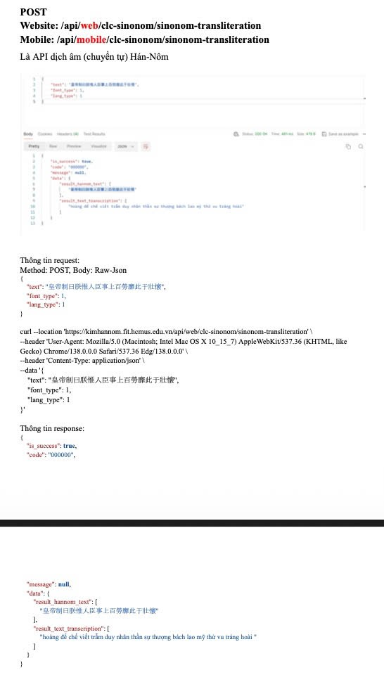

# Pipeline xử lý sách Hán Nôm

Gồm hai phần:

- **Web UI `app.py`**: gán loại sách, tách PDF thành ảnh từng trang, gán nhãn trang (`ch`, `vi`, `blank`, ...) để chuẩn bị dữ liệu nộp bài. Xem [mục Web UI](#web-ui-apppy). **Không cần token.**
- **API Kim Hán Nôm** (`scripts/api/`): các hàm Python gọi API upload ảnh, OCR và dịch âm Hán-Nôm của `https://kimhannom.fit.hcmus.edu.vn/`, dùng trong pipeline xử lý. Xem [mục 2 trở đi](#2-lấy-token).

## Cấu trúc thư mục

```
GK/
├── .env                  <- điền TOKEN vào đây
├── .env.example          <- file mẫu
├── requirements.txt      <- thư viện cơ bản
├── requirements-ocr.txt  <- thêm cho OCR cục bộ (PaddleOCR-VL, Kraken)
├── app.py                <- file chính: Web UI (gán loại sách, tách trang), chạy `python app.py`
├── web/index.html        <- giao diện của app.py
├── data/                 <- dữ liệu (không đưa lên git), cấu trúc giống thư mục nộp bài
│   ├── cache/            <- cache dùng chung: type.json (loại sách), uploads.json (lịch sử upload ảnh)
│   └── <Tên sách>/       <- <Tên sách>.pdf, ch/ vi/ intro/ ref/ toc/ blank/ misc/ và cache/ (không nộp)
├── img/                  <- ảnh dùng để test
├── scripts/
│   ├── library.py            <- cấu trúc thư mục data/, đường dẫn dùng chung
│   ├── book_types.py         <- loại sách (T1, T2, ...) và type.json
│   ├── page_splitter.py      <- tách PDF thành ảnh JPEG (thư viện + dòng lệnh)
│   ├── page_cache.py         <- cache nhãn từng trang (cache/phan_loai.json)
│   ├── blank_detector.py     <- nhận diện nhanh trang blank từ PDF (numpy + OpenCV), có dòng lệnh
│   ├── auto_tag.py           <- tự gán ch/vi/ch_vi theo loại sách (sau blank), có dòng lệnh
│   ├── split_jobs.py         <- tách trang chạy nền, nhận diện trang blank, tự gán nhãn, ảnh thu nhỏ cho Web UI
│   ├── page_classifier.py    <- phân loại từng trang vào ch/ vi/ ... (Web UI cũ + dòng lệnh)
│   ├── pdfslice_split.py     <- tách PDF bằng pdfslice_py (công cụ cũ)
│   └── api/
│       ├── sinonom_api.py       <- 3 hàm gọi API, trả nguyên JSON server trả về
│       ├── sinonom_service.py   <- hàm dùng cho pipeline: kiểm tra lỗi, trả `data`, lưu lịch sử upload
│       └── sinonom_demo.py      <- file chạy thử các hàm service
└── docs/images/          <- ảnh tài liệu API
```

## Web UI (`app.py`)

### Chạy

```bash
pip install -r requirements.txt     # chỉ cần thư viện cơ bản, không cần requirements-ocr.txt
python app.py
```

App mở trình duyệt tại `http://localhost:8766` (nếu cổng bận thì thử cổng kế tiếp, tối đa 20 cổng; địa chỉ thật được in ra console). Nhấn **Ctrl+C** ở console để dừng.

| Tuỳ chọn | Ý nghĩa |
|---|---|
| `--data DIR` | Thư mục dữ liệu (mặc định `data/`) |
| `--type-file FILE` | File JSON lưu loại sách (mặc định `<data>/cache/type.json`) |
| `--port N` | Cổng bắt đầu (mặc định `8766`) |
| `--no-browser` | Không tự mở trình duyệt |

App chỉ lắng nghe ở `127.0.0.1` (chỉ máy bạn truy cập được).

### Chuẩn bị dữ liệu: bỏ file PDF vào `data/`

`data/` không được đưa lên git (trừ `data/cache/`), nên sau khi clone repo bạn tự chép PDF vào. Thư mục `data/` và `data/cache/` đã có sẵn trong repo; nếu thiếu thì app tự tạo.

**Cách 1 (đơn giản nhất): chép thẳng file PDF vào `data/`**

```
data/
├── Kim Vân Kiều tân truyện.pdf
└── Tống Trân tân truyện.pdf
```

Chạy `python app.py` (hoặc tải lại trang web nếu app đang chạy), mỗi PDF tự được chuyển vào thư mục riêng cùng tên và app tạo sẵn các thư mục con:

```
data/
├── cache/
├── Kim Vân Kiều tân truyện/
│   ├── Kim Vân Kiều tân truyện.pdf
│   ├── ch/ vi/ intro/ ref/ toc/ blank/ misc/ cache/
└── Tống Trân tân truyện/
    └── ...
```

Console in dòng `Đã chuyển '<tên>.pdf' vào <tên>/` cho mỗi file được chuyển.

**Cách 2: tự tạo thư mục sách**

Tạo `data/<Tên sách>/` rồi bỏ file đúng tên `<Tên sách>.pdf` vào trong. Tên thư mục và tên file PDF phải trùng nhau (không phân biệt hoa thường), nếu không app không nhận ra đó là một sách.

**Lưu ý**

- Tên file PDF cũng là tên sách trong app và là khoá trong `type.json`, nên đặt tên rõ ràng và **đừng đổi tên sau khi đã gán loại** (đổi tên thì loại cũ thành mục "trong type.json không có PDF tương ứng" ở cuối danh sách).
- Tiếng Việt có dấu, dấu cách và chữ Hán trong tên đều dùng được.
- Không bao giờ ghi đè: nếu `data/<Tên sách>/` đã có PDF cùng tên thì file lẻ bị bỏ qua và app in `Bỏ qua '<tên>.pdf': ... đã có PDF cùng tên`. Hãy đổi tên hoặc xoá bản cũ rồi tải lại trang.
- Tên `cache` và tên bắt đầu bằng dấu `.` không dùng được làm tên sách.
- Chỉ nhận file `.pdf` nằm trực tiếp trong `data/` hoặc trong đúng một thư mục sách; PDF lồng sâu hơn không được nhận.
- Muốn dùng thư mục khác: `python app.py --data <đường dẫn>`.
- Sau khi chép thêm PDF khi app đang chạy, **tải lại trang (F5)** là thấy sách mới trong danh sách và app tự bắt đầu nhận diện trang trắng, gán nhãn.

### Quy trình dùng

1. **Màn hình danh sách**: mỗi dòng là một sách. Dùng ô tìm kiếm và bộ lọc loại để lọc. Bấm vào nhãn loại hoặc nút **Chọn loại** để chọn loại sách (T1, T2, Tnom, ...; xem bảng bên dưới), nút **Xem PDF** mở file gốc ở tab mới. Chọn xong bấm **Save** để lưu vào `data/cache/type.json` (chưa lưu thì có chữ "Chưa lưu" và trình duyệt cảnh báo khi đóng tab).
2. **Tách trang**: bấm **Trang** ở dòng của sách để vào màn hình trang, chọn DPI (150 / 200 / 300 / 400, mặc định 300), bấm **Tách trang**. Ảnh JPEG lưu ở `data/<Tên sách>/cache/pages/` (`<Tên sách>.001.jpg`, ...), thanh tiến trình hiện trong lúc chạy. Mặc định bỏ qua trang đã có ảnh hợp lệ; tích **Ghi đè** để tách lại tất cả. Mỗi lúc chỉ tách một sách, bấm thêm sẽ báo bận.
3. **Xem và gán nhãn trang**: lưới ảnh thu nhỏ của mọi trang, mỗi trang có nhãn hiện tại. Lọc theo nhãn bằng ô **Lọc**. Chọn trang bằng ô tích ở góc ảnh, hoặc gõ khoảng vào ô **Trang** rồi bấm **Chọn** (`1-5, 8, 10-12`; `40-` là từ trang 40 đến hết; `a:b:c` có bước nhảy, ví dụ `2::2` là mọi trang chẵn), hoặc **Chọn tất cả** (theo bộ lọc đang hiển thị) / **Bỏ chọn**. Sau đó bấm **Gán nhãn ▾** và chọn nhãn cho các trang đã chọn. Nút **ⓘ** hiện mô tả từng nhãn. Bấm vào ảnh một trang để xem ảnh đầy đủ (phím **←** **→** chuyển trang đang hiển thị, **Esc** hoặc bấm ra ngoài để đóng).
4. Nhãn được lưu ngay vào `data/<Tên sách>/cache/phan_loai.json`, không cần bấm Save.

Các nhãn trang: `ch` (Hán Nôm), `vi` (Quốc ngữ), `ch_vi` (cả hai, bố cục T2b), `intro`, `toc`, `ref`, `blank`, `misc`, `unknown` (chưa gán, mặc định).

### Loại sách

| Loại | Ý nghĩa |
|---|---|
| T1 / T1w | Quốc ngữ ở phần đầu, Nôm ở phần cuối (w: viết tay) |
| T2 / T2w | Xen kẽ, ví dụ phải Nôm, trái Quốc ngữ (w: viết tay) |
| T2b | Quốc ngữ và Nôm chung trang |
| Tnom / Tnomw | Chỉ có Nôm (w: viết tay) |
| Tqn | Chỉ có Quốc ngữ |
| Tref | Tham khảo |
| Tx | Loại khác |
| chưa phân loại | Mặc định |

### Thư mục sinh ra

```
data/
├── cache/type.json                 <- loại từng sách
└── <Tên sách>/
    ├── <Tên sách>.pdf
    ├── ch/ vi/ intro/ ref/ toc/ blank/ misc/   <- cấu trúc nộp bài
    └── cache/                      <- không nộp
        ├── pages/                  <- ảnh JPEG đã tách
        ├── thumbs/                 <- ảnh thu nhỏ cho Web UI
        └── phan_loai.json          <- nhãn từng trang
```

### Tự gán nhãn trang

Không cần bấm nút nào. Khi chạy `python app.py`, khi có PDF mới trong `data/` hoặc khi lưu loại sách mới, một luồng nền tự gán `blank` cho trang trắng rồi chia các trang `unknown` còn lại theo loại sách (tiến trình hiện ở dòng thống kê của sách). Sách đã xử lý và không đổi loại thì không chạy lại. Khi loại sách đổi, các nhãn `ch`/`vi`/`ch_vi` do máy gán được gán lại theo loại mới, nhãn gán tay giữ nguyên. Cũng chạy được bằng dòng lệnh: `python -m scripts.auto_tag [--book TÊN]`.

| Loại sách | Nhãn |
|---|---|
| Tnom, Tnomw | tất cả `ch` |
| Tqn | tất cả `vi` |
| T2b | tất cả `ch_vi` |
| T1, T1w | nửa đầu `vi`, nửa sau `ch` |
| T2, T2w | xen kẽ `ch`, `vi`, `ch`, `vi`, ... (Nôm trước, bỏ qua blank) |
| Tref, Tx, chưa phân loại | không gán, gán tay |

Đây là giả định theo bố cục nên có thể sai (T2 thực tế có thể xen kẽ theo khối, ranh giới T1 hiếm khi đúng giữa). Chỉ trang `unknown` bị đổi và trang đã có nhãn không tính vào chuỗi xen kẽ/chia đôi. Vì máy tự gán ngay khi mở app, hãy duyệt lưới trang và sửa tay `intro`, `toc`, `ref`, `misc` cùng các trang gán sai; nhãn sửa tay không bị ghi đè. Kiểm tra quy tắc bằng `python tests/test_auto_tag.py`.


## 1. Cài đặt

```bash
pip install -r requirements.txt        # cơ bản: app, tách trang, gọi API
pip install -r requirements-ocr.txt    # tùy chọn: OCR/layout cục bộ (PaddleOCR-VL, Kraken); cài torch trước
```

## 2. Lấy token

Token là chuỗi xác thực tài khoản của bạn. **Không chia sẻ token cho người khác.**

### Cách A: lấy từ Cookies

1. Đăng nhập vào website (link "này" trong tài liệu API) và giữ nguyên trang sau khi đăng nhập.
2. Nhấn **F12** (hoặc Ctrl + Shift + I) để mở Inspect.
3. Chọn tab **Application** (Chrome/Edge/Cốc Cốc) hoặc **Storage** (Firefox).

   > Đây chỉ là trang tổng quan. **Không bấm "Clear selected"** vì sẽ xóa cookie và đăng xuất bạn.

4. Ở cột trái, mở **Cookies**, bấm vào tên miền `https://kimhannom.fit.hcmus.edu.vn`.
5. Tìm dòng có **Name = `token`**, bấm vào dòng đó rồi copy toàn bộ giá trị ở cột **Value**.

   Nếu chỉ thấy các cookie như hình dưới (`_ga...`, `_clck`, `mf_user`) thì **chưa có token**: đây toàn là cookie theo dõi. Hãy đăng nhập lại, nhấn F5 rồi xem lại, hoặc dùng Cách B.

### Cách B: lấy từ tab Network

1. Đăng nhập vào website, mở Inspect, chọn tab **Network**.
2. Nhấn **F5** để tải lại trang (hoặc thực hiện một thao tác như OCR một ảnh để trang gọi API).
3. Gõ `api` vào ô Filter, bấm vào một request bất kỳ.
4. Chọn tab **Headers**, kéo xuống **Request Headers**, tìm dòng `Authorization: Bearer ...`.
5. Copy phần chuỗi **sau chữ `Bearer `**. Đó chính là token.

## 3. Điền token vào `.env`

Mở file `.env` và dán token vào sau dấu `=`:

```
TOKEN=eyJhbGciOi...đoạn-token-của-bạn...
```

- Không cần ngoặc kép.
- Không gõ chữ `Bearer` (code tự thêm vào header). Chỉ dán phần token.
- Token hết hạn thì đăng nhập lại, lấy token mới và thay vào đây.
- File `.env` đã được thêm vào `.gitignore`, đừng đưa nó lên git hay gửi cho người khác.

## 4. Sử dụng

Có hai lớp, cả hai nằm trong `scripts/api/`:

- **`sinonom_api.py`**: mỗi hàm gọi đúng một endpoint và trả về nguyên JSON server trả về (`is_success`, `code`, `message`, `data`), không kiểm tra hay xử lý gì.
- **`sinonom_service.py`**: lớp dùng cho pipeline. Kiểm tra `is_success` / `code`, lỗi thì ném `ApiError`, thành công thì trả về phần `data`. Ghi lịch sử upload vào `data/cache/uploads.json`.

### Hàm service

```python
import sys; sys.path.insert(0, "scripts/api")
from sinonom_service import upload, ocr, ocr_file, transliterate, load_uploads, ApiError

file_name = upload("img/test_api/test_1.png")       # trả về file_name trên server
data = ocr("img/test_api/test_1.png", ocr_id=2, lang_type=2)
data["result_ocr_text"]                              # list: mỗi phần tử là một dòng chữ
ocr_file(file_name, ocr_id=1)                        # OCR file đã có sẵn trên server

tr = transliterate("皇帝制曰朕惟人臣事上百勞靡此于壯懷")
tr["result_hannom_text"]                             # list văn bản Hán-Nôm theo dòng
tr["result_text_transcription"]                      # list phiên âm Quốc ngữ tương ứng

load_uploads()                                       # các lần upload đã ghi
```

| Hàm | Endpoint | Việc làm |
|---|---|---|
| `upload(image_path, force=False)` | `image-upload` | Upload ảnh, trả về `file_name`. Ảnh cùng nội dung đã upload (theo sha256) thì dùng lại `file_name` cũ, `force=True` để upload lại. |
| `ocr_file(file_name, **params)` | `image-ocr` | OCR file đã có trên server. Trả về `data`: `result_ocr_text`, `result_bbox`, `result_file_name`. |
| `ocr(image_path, **params)` | `image-upload` + `image-ocr` | Upload (nếu cần) rồi OCR. Nếu server báo `000404` (không còn file) thì tự upload lại một lần. |
| `transliterate(text, font_type=1, lang_type=1)` | `sinonom-transliteration` | Dịch âm Hán-Nôm. Trả về `data`: `result_hannom_text`, `result_text_transcription`. |
| `load_uploads()` | không gọi API | Đọc lịch sử upload từ `data/cache/uploads.json`. |

`result_ocr_text` là list: mỗi phần tử là một dòng chữ server nhận ra trên ảnh (với chữ viết dọc thì là một cột). Một số ký tự Nôm chưa có mã Unicode chính thức được server trả về bằng mã trong vùng private use, nên có thể hiện thành ô trống tuỳ font.

### Lịch sử upload (`data/cache/uploads.json`)

Mỗi lần upload thật được ghi thêm một bản ghi, `image_path` tính tương đối từ gốc dự án (ảnh nằm ngoài dự án thì lưu đường dẫn tuyệt đối):

```json
[
  {
    "image_path": "img/test_api/test_1.png",
    "sha256": "67062d62...",
    "file_name": "upload_72243aa75b744d9595cae62f57694767.png",
    "uploaded_at": "2026-11-03T03:55:12+00:00"
  }
]
```

Đổi vị trí file bằng biến môi trường `UPLOADS_FILE`. File này chỉ thêm bản ghi, không xoá, và không có cơ chế khoá nên không nên cho nhiều tiến trình cùng ghi.

### Gọi API thô

```python
import sinonom_api

up = sinonom_api.upload_image("image.png")           # {"is_success": ..., "code": ..., "data": {"file_name": ...}}
res = sinonom_api.ocr(up["data"]["file_name"], ocr_id=2, lang_type=2)
res = sinonom_api.transliterate("皇帝")
```

### Chạy thử

`scripts/api/sinonom_demo.py` là nơi thử nhanh các hàm service. Sửa `IMAGE` và `TEXT` ở đầu file, bỏ comment dòng muốn thử rồi chạy:

```bash
python scripts/api/sinonom_demo.py
```

## 5. Tham số

| Tham số | Giá trị |
|---|---|
| `ocr_id` | 1: thông thường dọc, 2: hành chính, 3: ngoại cảnh, 4: thông thường ngang |
| `lang_type` | 0: chưa biết, 1: Hán, 2: Nôm |
| `epitaph` | 0: văn bản thường, 1: văn bia |
| `reading_direction` | 1: dọc (mặc định), 2: ngang (không bắt buộc) |
| `tag` | mặc định `null`; gán `model_id` được cấp riêng nếu muốn dùng mô hình chuyên biệt |
| `font_type` (dịch âm) | tài liệu không giải thích, ví dụ dùng `1` |

Mặc định `ocr()` / `ocr_file()` dùng `ocr_id=2`, `lang_type=2`, `epitaph=0` (ví dụ trong tài liệu dùng `epitaph=1`). Đổi bằng cách truyền tham số cùng tên, ví dụ `ocr(path, ocr_id=1, lang_type=1)`.

## 6. Lỗi thường gặp

| Hiện tượng | Cách xử lý |
|---|---|
| Server trả `code` khác `000000` (service ném `ApiError`) | Xem `message.title` / `message.text` / `debug_msg` trong thông báo lỗi. |
| Lỗi xác thực (token sai hoặc hết hạn) | Điền `TOKEN` trong `.env`; hết hạn thì đăng nhập lại, lấy token mới. Code không còn kiểm tra token riêng, nên lỗi do server trả về. |
| Bị chặn dù token đúng | `User-Agent` không được bắt đầu bằng `python-requests`. Mặc định đã là User-Agent trình duyệt; chỉ cần kiểm tra nếu bạn đổi `USER_AGENT` trong `.env`. |
| `[000404] t_file_not_found` | `file_name` không có trên server. Hay gặp khi đưa đường dẫn ảnh trên máy vào `ocr_file()`: hàm này cần `file_name` do `upload()` trả về. `ocr()` tự upload lại khi gặp lỗi này. |
| Chữ Hán hiện thành `?` trên console Windows | Đặt `sys.stdout.reconfigure(encoding="utf-8")` trước khi in, hoặc ghi kết quả ra file UTF-8. |

## 7. Tài liệu API gốc (ảnh)

### Cấu trúc chung: domain, header, cách lấy token


### Cấu trúc JSON response chuẩn


### Lưu ý với thư viện `requests` của Python


### API upload ảnh: `/api/web/clc-sinonom/image-upload`


### API OCR: `/api/web/clc-sinonom/image-ocr`


### API dịch âm: `/api/web/clc-sinonom/sinonom-transliteration`


Với mobile, thay `/api/web/` bằng `/api/mobile/` (đặt `PLATFORM=mobile` trong `.env`).
